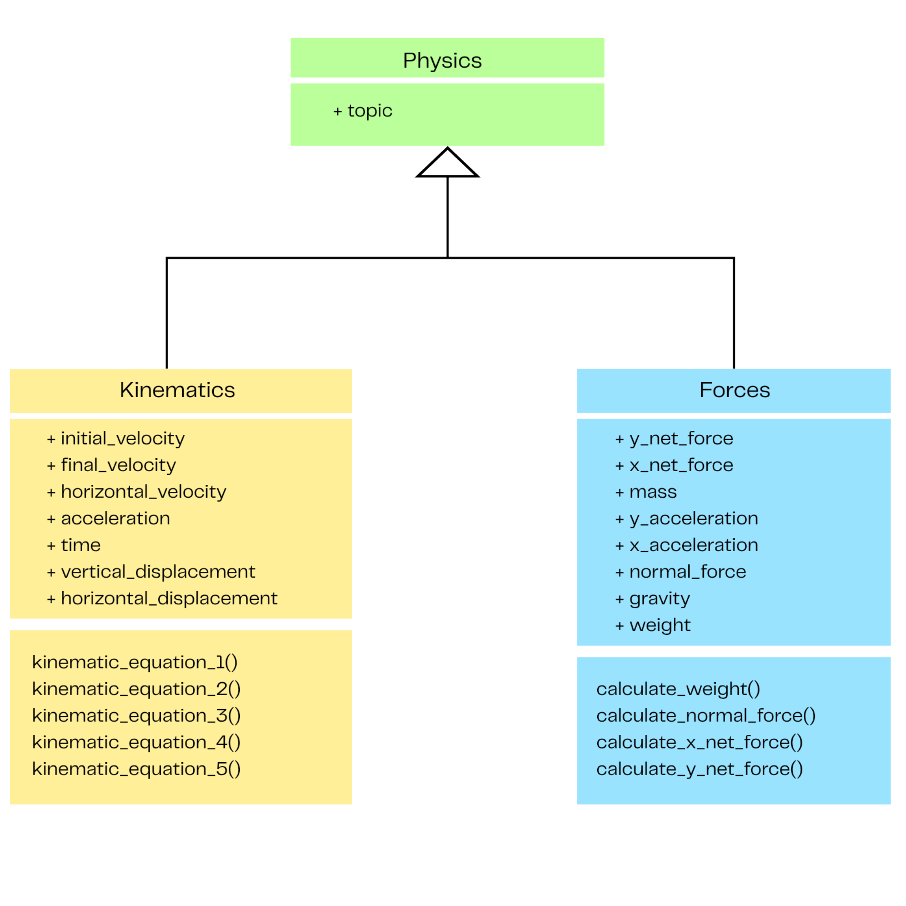

# CS3SY26-Mg-ProjectProposal_6

<h2>
Name of the Application	: Tamagotchi Pet Simulator 
Section			   	    : Magnesium 
Group Members			: Mayen Elise F. Ilagan, Sophia E. Ramirez, Kamilah R. Villadelrey 		
Date (Proposal Date)	: November 5, 2026 
</h2>

## Project Description:
This program is a calculator that can return a needed value based on other physics quantities given by the user. For example, it can find an object’s initial velocity when a user gives the object’s final velocity, acceleration, and time in motion. It uses the kinematic equations and derives from Newton’s second law of motion, depending on the user’s needs. Target demographics of this project include physics students, physics teachers, and physicists, as it can help with tedious calculations.
 
The program has a main class, <b>Physics</b>, which has the attribute topic, which stores either kinematic or force, to specify what kind of calculation the program needs. Physics class also has 2 subclasses, <b>Kinematics</b>, and <b>Forces</b>. Kinematics has attributes initial_velocity, final_velocity, horizontal_velocity, acceleration, time, vertical_displacement, and horizontal_displacement, and has methods kinematic_equation_1(), all the way until kinematic_equation_5(), representing each kinematic equation. The Forces class has attributes y_net_force, x_net_force, mass, y_acceleration, x_acceleration, normal_force, gravity, and weight, and has methods calculate_weight(), calculate_normal_force(), calculate_x_net_force(), and calculate_y_net_force()

### Class Diagram:

    

## Goals:

The long-term goal of this project is to develop a reliable and user-friendly calculator that simplifies solving physics problems involving kinematics and forces. It aims to help students, teachers, and anyone studying or working with physics perform calculations efficiently, minimize errors, and better understand relationships between physics quantities and concepts. Through the use of object-oriented programming, this application will provide an organized system for solving physics equations and determining unknown quantities based on the information given by the user.

* <b>Objective 1</b>: Develop a functional calculator that can solve the 5 kinematic equations and calculate important quantities related to kinematics and forces, like weight, normal force, and net force along the x-axis and y-axis.  
* <b>Objective 2</b>: Implement an organized object-oriented structure using a main Physics class, Kinematics and Forces subclasses, and the appropriate attributes and method to handle different types of physics calculations.  
* <b>Objective 3</b>: Design the program to enable users to input known physics quantities and obtain the corresponding unknown values accurately and efficiently, making the calculations more convenient and accessible.
